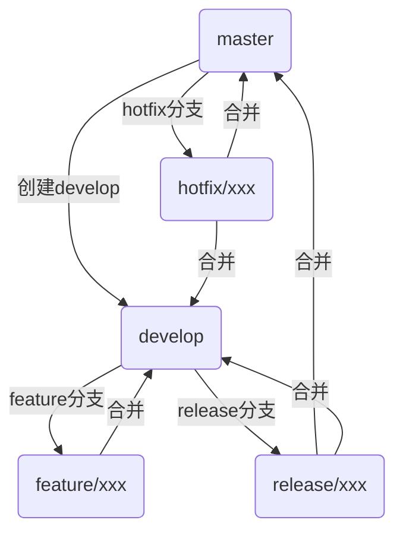

# Git Flow 工作流与团队协作

## 概要

Git Flow 是一种基于 Git 的分支管理工作流程模型，由 Vincent Driessen 在 2010 年提出。它为软件开发项目定义了严格的分支模型，适合有固定发布周期的项目。

## 一、Git Flow 理论

### 1. 分支管理规范

<!-- oxfmt-ignore-start -->
| 分支类型 | 来源分支 | 合并目标 | 主要用途 | 注意事项 |
| :---------------------- | :----------------- | :----------------- | :------------ | :------------------------ |
| **主分支(main)**        | - | 最终发布 | 存放稳定、可发布代码 | 🚫 禁止直接提交代码；通过 PR 合并；由负责人维护 |
| **修复分支(hotfix/x)**  | main | main、dev | 紧急线上缺陷修复 | 命名遵循 `hotfix/缺陷编号`；修复完成后需同步回 `dev` |
| **发布分支(release/x)** | dev | main、dev | 版本上线前的预发布集成、测试与缺陷修复 | 命名遵循 release/版本号；仅做测试与 Bug 修复，禁止新增功能；发布后打 Tag，并同步回 dev |
| **开发分支(dev)** | main（首次创建） | main（定期合并） | 日常开发集成，汇总功能分支 | 团队成员统一从此分支拉取最新代码 |
| **功能分支(feature/x)** | dev | dev | 单个功能开发  | 命名遵循 `feature/功能名称`；开发完成后合并回 `dev` |
<!-- oxfmt-ignore-end -->

### 2. 分支类型与职责

**长期分支**

- **main/master**：存放稳定、可随时部署到生产环境的代码。每一次提交都对应一个可发布的版本。不允许直接在此分支上开发，会被打上版本标签。
- **develop**：存放最新的开发成果的集成分支，是功能开发的集线器，作为下一个发布版本的基础。当dev分支上的代码达到稳定状态并准备发布时，会合并到main分支。所有的功能分支、发布分支都从dev分支拉取。

**临时分支**

- **feature/**：开发新功能的分支，从 develop 分支分出，完成后合并回 develop。
- **release/**：准备发布新版本的分支，从 develop 分支分出，完成后合并回 main 和 develop。
- **hotfix/**：修复生产环境紧急问题，从 main 分支分出，完成后合并回 main 和 develop。
- **support/**（可选）：长期维护的历史版本分支。

## 二、常用命令与工作流示意图

:::code-group
```bash [命令]
# 初始化 git flow
git flow init

# 新建功能分支
git flow feature start <name>
git flow feature finish <name>

# 新建预发布分支
git flow release start <version>
git flow release finish <version>

# 新建热修复分支
git flow hotfix start <version>
git flow hotfix finish <version>
```


:::

## 三、代码拉取与更新流程

### 1. 拉取远程最新代码

在开发中，我们经常需要让自己的 feature 分支保持与 main 同步，以获得最新的代码、修复冲突、减少后续合并的代价。**优先使用变基拉取，保持提交历史线性**。以下是最简单、最方便的拉取合并方式：

| 操作方式         | 命令                            | 本质行为       | 历史效果               |
| ---------------- | ------------------------------- | -------------- | ---------------------- |
| 合并（多人协作） | `git pull origin main`          | fetch + merge  | 有合并提交（非线性）   |
| 变基（单人开发） | `git pull --rebase origin main` | fetch + rebase | 无合并提交（线性历史） |

:::details 复杂方式

我们还可以使用这种复杂方式 **(部分等价于上面方式)**：用 rebase 替代 merge，让提交历史更整洁。`merge` 会产生一个额外的 “合并 commit”，`rebase` 可以把你的提交 “嫁接” 到目标分支最新版本上，历史更线性。

:::code-group
```sh [feature分支是个人开发]
# 比如在 feature 分支，想同步 main 的最新代码：

# 1. 确保本地 main 分支是最新的（先拉取主分支最新代码）
git checkout main
git pull origin main

# 2. 切回 feature 分支，用 rebase 同步 main 的修改
git checkout feature
git rebase main # 把 feature 的提交放在 main 最新提交之后

# 3. 若有冲突，解决后执行：
git add .  # 标记冲突已解决
git rebase --continue  # 继续完成 rebase，直到结束

# 4. 由于 rebase 改写了历史，需要强制推送（用 --force-with-lease 更安全）
git push --force-with-lease origin feature

# （注意：已 push 到远程的分支不要用 rebase，会打乱他人历史）
```

```sh [feature 分支是多人协作]
# 1. 确保本地 main 分支是最新的
git checkout main
git pull origin main

# 2. 切回 feature 分支，合并 main 的修改
git checkout feature
git merge main

# 3. 若有冲突，解决后执行：
git add .
git commit -m "merge: 同步 main 分支最新代码"  # 会自动生成合并 commit，可修改提交信息

# 4. 正常推送（无需强制，因为 merge 没有改写历史，只是新增了合并 commit）
git push origin feature
```
:::

### 2. 推送最新代码

提交前执行本地测试、代码 lint 检查，确保无语法错误和风格问题。

```bash
# 如 git push origin feature/user-login:feature/user-login
git push origin 本地分支:远程分支
```

### 3. 代码合并（Pull Request）流程

1. **发起 PR**

- 功能 / 修复完成后，从个人分支向develop（或对应目标分支）发起 PR。
- PR 描述需包含：功能说明、测试点、关联的需求 / 缺陷编号（如 Jira 工单）。

2. **代码评审（Code Review）**

- 至少由 1 名团队成员（非作者）评审，关注：代码逻辑合理性、可读性等
- 评审通过后，由作者或项目负责人执行合并。

3. **合并操作**

- 优先使用 **squash 合并**（将多个提交压缩为一个），保持历史简洁。如：GitHub：在 PR 界面选择「Squash and Merge」；命令行则 git merge --squash 源分支，再提交合并信息。
- 若需保留提交历史（如修复分支），可使用常规合并。

## 四、常见问题

**Q: Git Flow 必须使用 git-flow 工具吗？**  
A: 不是必须的，git-flow 工具只是简化了操作，你可以手动按照 Git Flow 的原则管理分支。

**Q: feature 分支需要 rebase 吗？**  
A: 可以但不必须。如果选择 rebase，应该在本地完成，避免已推送的分支被重写历史。

**Q: 如何与远程仓库协作？**  
A: 每个功能/发布/热修复分支都可以推送到远程，便于团队协作和代码审查。

**Q: 分支合并冲突多怎么办？**  
A: 建议及时合并 develop，保持分支同步，减少冲突。

**Q: 适合小型项目吗？**  
A: 小型项目或快速迭代项目可以考虑简化分支策略，如 GitHub Flow。

**Q: 优缺点：**

A：优点 - 分支结构清晰，职责明确；适合有发布周期的项目；支持多人协作。

A：缺点 - 分支较多，管理复杂，不适合持续交付、快速迭代的项目。

## 五、版本发布流程

1. **从 dev 合并到 main**

发布前在develop分支执行全量测试，确认无问题后发起 PR 合并到main。

2. **打标签（Tag）**

合并完成后，在main分支打版本标签，格式：v版本号（如v1.0.0）：

```bash
git tag -a v1.0.0 -m "版本1.0.0发布，包含用户注册、登录功能"
git push origin v1.0.0
```

3. **冲突解决规范**

冲突产生场景：多人修改同一文件的同一部分，拉取或合并时触发。解决步骤：

- 本地拉取最新代码（git pull --rebase），定位冲突文件。
- 手动解决冲突（保留正确逻辑，删除冲突标记<<<<<<< ======= >>>>>>>）。
- 提交解决后的代码：`git add 冲突文件 && git rebase --continue`（若使用变基）或常规提交后推送。
- 若冲突复杂，及时与相关开发人员沟通，避免误删逻辑。

## 小结

### 1. Git 别名与工具优化

为提升效率，可配置全局 Git 别名（如前文提到的git pr）：

```bash
# 配置变基拉取别名
git config --global alias.pr "pull --rebase"
# 配置快速查看提交历史（简洁版）
git config --global alias.lg "log --oneline --graph --decorate --all"
```

通过以上流程，可实现团队协作中代码版本的高效管理、历史追溯与风险控制，保障项目稳定迭代。
